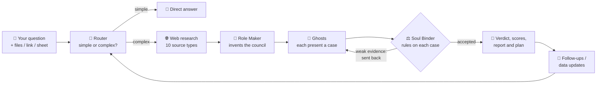

<div align="center">

# 💀 Project Necromancer

### *From idea to afterlife.*

**An AI courtroom for your business.** Describe a company (or upload its numbers) and a council of AI specialists researches it live, argues its case, and a judge hands you a **verdict with sources** and a **plan you can act on**.


</div>

---

## 📖 Table of contents

1. [What is Necromancer?](#-what-is-necromancer)
2. [Key features](#-key-features)
3. [Quick start (5 minutes)](#-quick-start-5-minutes)
4. [How to use it](#-how-to-use-it)
5. [How it works](#-how-it-works)
6. [The maths behind the verdict](#-the-maths-behind-the-verdict)
7. [Sample data](#-sample-data)
8. [API reference](#-api-reference)
9. [Project structure](#-project-structure)
10. [Testing](#-testing)
11. [Troubleshooting](#-troubleshooting)
12. [Team](#-team)

---

## 💡 What is Necromancer?

Most business advice is either **generic** ("know your customer") or **expensive** (a consultant). Necromancer gives a business owner a clear answer to one question:

> **"Where does my business stand, and what should I do next?"**

It works at **every stage of a company's life**:

| Stage | Situation | Example question |
|:---:|---|---|
| 🌱 **Launch** | An idea, not yet started | *"Should I start a tiffin service for students in Pune?"* |
| 📈 **Grow** | A working business | *"We're profitable. Should we open in two new cities?"* |
| 🚑 **Rescue** | Sales or cash are falling | *"My phone shop's sales halved since March. Why?"* |
| 🧟 **Revive** | The company already shut down | *"Why did Simpl die, and should someone relaunch it?"* |

### The one rule that makes it trustworthy

> **AI weighs the evidence. Plain code does the maths. Every claim carries a source.**

Numbers from your spreadsheets are **read by code, never guessed by the AI**, so totals, growth rates and scores are always exact and repeatable.

---

## ✨ Key features

### ⚖️ The AI courtroom
- **A council invented for your case.** A *Role Maker* agent reads your situation and creates the right specialists (e.g. *Skeptical CFO*, *Rival Founder*, *Compliance Guardian*). Nothing is hard-coded.
- **Live multi-source research.** Each specialist ("ghost") searches the web, news, Reddit, Hacker News, Wikipedia, Yahoo Finance, job boards, review sites and World Bank data, and **keeps every source link**.
- **A strict judge.** The **Soul Binder** cross-examines every case and **sends weak ones back** to do more research before ruling.
- **A full report.** Verdict, confidence, scores, competitors (listing status **verified by code**), risks, and a step-by-step action plan.
- **Follow-up questions.** The council remembers the verdict, so you can keep asking.

### 📊 Your numbers, done right
- **Upload documents:** PDF, **Excel (`.xlsx`)**, CSV, DOCX, TXT or Markdown (up to 3 files, 5 MB each).
- **Google Sheets connector:** paste a shared link and every tab is read automatically.
- **A health score computed in code:** every spreadsheet gets a **0–100 score** from its own numbers.

### 🔁 See how changes move the verdict
- **Compare ledgers:** upload **2–6 spreadsheets** (e.g. *last year vs this year*, or *actual vs what-if*) and see:
  - the verdict for each file,
  - **every changed cell** (old → new, Δ and %),
  - **why the score moved**, in plain English.
- **Update your data:** on any finished case, choose a **new version of a file** (or re-read your Google Sheet). Necromancer shows exactly what changed and the council **re-judges** with the new numbers.

---

## 🚀 Quick start (5 minutes)

### Prerequisites

| Tool | Version | Check with |
|---|---|---|
| **Python** | 3.12+ | `python --version` |
| **Node.js** | 20+ | `node -v` |
| **Gemini API key** | free tier is fine | [Google AI Studio](https://aistudio.google.com/apikey) |

### 1️⃣ Set up the backend

```powershell
# from the project root (the folder that contains backend/ and frontend/)
python -m venv .venv

# Windows
.\.venv\Scripts\pip install -r backend\requirements.txt
# macOS / Linux
# .venv/bin/pip install -r backend/requirements.txt
```

Create **`backend/.env`** (this file is git-ignored, so your keys stay private):

```ini
# One key is enough. Keys from DIFFERENT Google accounts add up to more free quota.
gemini_key=YOUR_KEY_HERE
# gemini_key_2=ANOTHER_KEY
# gemini_key_3=ANOTHER_KEY
```

> [!CAUTION]
> **Never put real keys in `backend/.env.example`.** That file is committed to git. If a key ever gets pushed, **revoke it** in Google AI Studio and create a new one.

### 2️⃣ Start the backend

```powershell
cd backend
..\.venv\Scripts\python -m uvicorn app.main:app --reload --port 8000
```

✅ Check it's alive: open **http://localhost:8000/api/health**. You should see `{"status":"ok"}`.
📚 Interactive API docs: **http://localhost:8000/docs**

### 3️⃣ Start the frontend (new terminal)

```powershell
cd frontend
npm install
npm run dev
```

🎉 Open **http://localhost:5173**. The frontend forwards every `/api/...` call to the backend on port 8000 automatically.

> [!TIP]
> **No API key yet?** Add `?mock=1` to the URL (e.g. `http://localhost:5173/?mock=1`) to replay a recorded case without the backend.

---

## 🧭 How to use it

### Ask the court a question

1. Pick your stage: **Launch**, **Grow**, **Rescue** or **Revive**.
2. Describe the situation in plain words.
3. *(Optional)* Add a website link, upload files, or connect a Google Sheet.
4. Choose **Fast** (about 1.5 min) or **Deep** (about 2.5 min, more thorough).
5. Click **Summon the council** and watch the case unfold live.

### Compare two versions of your numbers

1. Click **📒 Compare Excel** in the header.
2. Upload 2–6 Excel/CSV files **oldest first**, or add a **Google Sheet** link.
   *No files handy? Click a **sample ledger** on the right.*
3. Click **Compare ledgers**.
4. Read the **verdict change**, the **reasons**, and the **changed cells** table.
5. *(Optional)* Click **Summon the council** to put both files on trial before the AI court.

> [!TIP]
> **Demo shortcut:** `http://localhost:5173/compare?sample=1` opens the Zomato FY23 → FY24 comparison straight away (`2` = Paytm, `3` = Nykaa what-if, `4` = all six).

### Update your data on an existing case

1. Open a finished case that has a document.
2. Under **Update your data**, click **Choose new version** next to the file.
3. A follow-up case opens with **"What changed in your numbers"**: the score before → after, the reasons, and every changed cell. The council then re-judges.

### Spreadsheet format that works best

One row per period, one column per metric. Headers are matched by meaning, so `Revenue`, `Sales` and `Turnover` all count as revenue.

| Period | Revenue | Expenses | Net Profit | Customers |
|---|---:|---:|---:|---:|
| Q1 FY25 | 1,746 | 1,731 | 13.6 | 1.2 |
| Q2 FY25 | 1,875 | 1,859 | 13.0 | 1.3 |

Formats like **`₹1,234 Cr`**, **`(120)`** (negative) and **`12.5%`** are understood.

---

## ⚙️ How it works



| Step | What happens | Who does it |
|---|---|---|
| **1. Read** | Your files are parsed **in memory** (never saved to disk). Spreadsheet numbers become exact statistics. | 🧮 Code |
| **2. Route** | Decides whether this is a quick question or needs the full court. | 🤖 AI |
| **3. Research** | Searches many free public sources and stores the best evidence in a vector index (BGE embeddings + FAISS). | 🧮 Code |
| **4. Assemble** | The Role Maker invents 3–8 specialists suited to *your* case. | 🤖 AI |
| **5. Testify** | Each ghost argues a position, backed by sources. | 🤖 AI |
| **6. Rule** | The Soul Binder accepts each case or sends it back for more research. | 🤖 AI |
| **7. Verify** | Competitors' stock listings and shutdown news are checked against Yahoo Finance and Google News. | 🧮 Code |
| **8. Report** | Verdict, 0–100 score, risks and a week-by-week plan, streamed live. | 🤖 AI + 🧮 Code |

> **Your files are data, never instructions.** Text inside an uploaded document can't redirect the AI.

---

## 🧮 The maths behind the verdict

Two scores appear in Necromancer. Both end up on the same **0–100** scale.

### 1. The court's score

The Soul Binder rates five dimensions from 0 to 10: **Market demand**, **Competition**, **Unit economics**, **Regulation & risk** and **Execution**. The overall score is computed **in code**, not by the AI:

$$
\text{Score}_{\text{court}} = \operatorname{round}\left(10 \times \frac{1}{5}\sum_{i=1}^{5} d_i\right), \qquad d_i \in [0, 10]
$$

### 2. The spreadsheet health score (computed 100% in code)

For a sheet with $n$ periods, let $R_t$ = revenue, $E_t$ = expenses, $P_t$ = net profit and $C_t$ = customers in period $t$. Every dimension is clipped to the range $[0, 10]$:

$$
\operatorname{clip}(x) = \min\big(10,\ \max(0,\ x)\big)
$$

| Dimension | What it measures | Formula |
|---|---|---|
| **Revenue growth** | Average growth per period | $g = \left(\dfrac{R_n}{R_1}\right)^{\frac{1}{n-1}} - 1, \quad \text{score} = \operatorname{clip}(4 + 40g)$ |
| **Consistency** | How often revenue didn't fall | $\text{score} = 10 \times \dfrac{\#\{t : R_{t+1} \ge R_t\}}{n-1}$ |
| **Profitability** | Overall net margin | $m = \dfrac{\sum P_t}{\sum R_t}, \quad \text{score} = \begin{cases} \operatorname{clip}(5 + 20m) & m < 0 \\ \operatorname{clip}(5 + 25m) & m \ge 0 \end{cases}$ |
| **Margin momentum** | Is the margin improving? | $\text{score} = \operatorname{clip}\big(5 + 25\,(m_n - m_1)\big)$ |
| **Cost efficiency** | Expenses per ₹1 of revenue | $r = \dfrac{\sum E_t}{\sum R_t}, \quad \text{score} = \operatorname{clip}\big(10 - 12\,(r - 0.7)\big)$ |
| **Customer traction** | Customer growth per period | $\text{score} = \operatorname{clip}(4 + 40\,g_C)$ |
| **Vs previous file** | Revenue vs the earlier file *(compare only)* | $y = \dfrac{\sum R_t}{\sum R^{\text{prev}}_t} - 1, \quad \text{score} = \operatorname{clip}(5 + 12.5\,y)$ |

The final health score averages whichever dimensions the sheet has data for:

$$
\text{Score}_{\text{health}} = \operatorname{round}\left(10 \times \frac{1}{k}\sum_{j=1}^{k} s_j\right)
$$

| Score | Verdict | Meaning |
|:---:|:---:|---|
| **70–100** | 🟢 **SCALE** | Growth and margins both work. Expansion is backed by the numbers. |
| **55–69** | 🟢 **GROW WITH CARE** | A working business with one weak spot to fix first. |
| **40–54** | 🟡 **RECOVERABLE** | Real revenue, but money is leaking. Fix the leak before growing. |
| **0–39** | 🔴 **CRITICAL** | The numbers are moving the wrong way. Cut losses and find what still works. |

### 3. What "changed" means

For every cell that differs between version $a$ and version $b$:

$$
\Delta = b - a, \qquad \%\,\text{change} = \frac{b - a}{|a|} \times 100
$$

Rows are matched **by label** when both files cover the same periods (a corrected sheet), or **by position** when they don't (Q1 FY23 ↔ Q1 FY24).

> **Worked example (Zomato FY23 → FY24).** Net margin went from $-13.7\%$ to $+2.9\%$, so profitability rose from $\operatorname{clip}(5 + 20 \times -0.137) = 2.3$ to $\operatorname{clip}(5 + 25 \times 0.029) = 5.7$. Together with the other dimensions, the overall score moved **55 → 75**: from **GROW WITH CARE** to **SCALE**.

---

## 📁 Sample data

Six ready-made workbooks live in **`frontend/public/samples/`**. They hold quarterly figures in ₹ crore from public results coverage, with sources listed inside each file.

| File | Company | Story | Health score |
|---|---|---|:---:|
| `zomato_fy2023.xlsx` → `zomato_fy2024.xlsx` | Zomato (Eternal) | From losses to first profit | **55 → 75** |
| `paytm_fy2024.xlsx` → `paytm_fy2025.xlsx` | Paytm (One97) | Revenue fell about 31% after the RBI action | **40 → 53** |
| `nykaa_fy2025.xlsx` → `nykaa_fy2025_whatif.xlsx` | Nykaa (FSN) | Same quarters, **expenses +3%** *(hypothetical)* | **60 → 58** |

Regenerate them at any time:

```powershell
cd backend
..\.venv\Scripts\python scripts\make_sample_excels.py
```

Two small CSVs for the "update your data" flow also live in `docs/samples/` (`phone_shop_v1.csv` → `phone_shop_v2.csv`).

---

## 🔌 API reference

Base URL: `http://localhost:8000`. Full interactive docs at **`/docs`**.

<details>
<summary><b>Cases &amp; the court</b></summary>

| Method | Endpoint | Purpose |
|---|---|---|
| `POST` | `/api/problem` | Open a case: `{problem_statement, url?, depth, document_ids?, stage?, strict?}` |
| `GET` | `/api/stream/{id}` | Live progress (Server-Sent Events) |
| `GET` | `/api/session/{id}` | Snapshot of a case |
| `GET` | `/api/session/{id}/events` | Every recorded event, for replaying a finished case |
| `POST` | `/api/session/{id}/followup` | Ask a follow-up question |
| `POST` | `/api/revive` | Investigate a dead startup from its URL |

</details>

<details>
<summary><b>Documents, spreadsheets &amp; Google Sheets</b></summary>

| Method | Endpoint | Purpose |
|---|---|---|
| `POST` | `/api/documents` | Upload files (multipart field `files`) and get back document ids |
| `POST` | `/api/connectors/google-sheet` | Read a shared Google Sheet as evidence: `{url}` |
| `POST` | `/api/connectors/google-sheet/file` | Download a shared sheet as `.xlsx` (used by Compare) |
| `POST` | `/api/compare` | Compare 2–6 spreadsheets (multipart `files`, oldest first) |
| `POST` | `/api/session/{id}/update-data` | Swap a file for a new version (multipart: `document_id`, `file`, `depth`) and re-judge |
| `POST` | `/api/session/{id}/refresh-data` | Re-read the case's Google Sheets and re-judge |

</details>

<details>
<summary><b>Companies &amp; connectors (storage layer)</b></summary>

| Method | Endpoint | Purpose |
|---|---|---|
| `POST` | `/api/companies` | Create a company |
| `GET` | `/api/companies/{id}` | Profile, connectors and financial records |
| `POST` | `/api/companies/{id}/connectors` | Register a data connector |
| `POST` | `/api/companies/{id}/financial-records` | Add one period's numbers |

</details>

---

## 🗂️ Project structure

```text
necromancer/
├── backend/                     # FastAPI + Gemma agents
│   ├── app/
│   │   ├── agents/              # Router, Role Maker, ghosts, Soul Binder, orchestrator
│   │   ├── routes/              # HTTP endpoints (problem, compare, documents, stream…)
│   │   ├── services/
│   │   │   ├── research.py      # multi-source web research
│   │   │   ├── documents.py     # PDF / Excel / CSV / DOCX reading
│   │   │   ├── spreadsheets.py  # health score, cell diff, compare (pure code)
│   │   │   ├── data_diff.py     # what changed between two file versions
│   │   │   ├── google_sheets.py # Google Sheets connector
│   │   │   └── memory.py        # BGE embeddings + FAISS vector store
│   │   └── main.py
│   ├── scripts/                 # sample-data generator and dev tools
│   └── tests/                   # pytest suite
├── frontend/                    # React 19 + Vite + Tailwind
│   ├── public/samples/          # sample Excel ledgers
│   └── src/
│       ├── App.tsx              # home page and intake form
│       ├── Case.tsx             # the live courtroom and report
│       ├── Compare.tsx          # ledger comparison page
│       ├── Sheet.tsx            # "what changed" and "update your data"
│       └── lib.ts               # API client and event handling
└── docs/                        # design notes, specs and research
```

---

## 🧪 Testing

```powershell
# backend: about 50 tests, takes about 10 seconds, no API key needed
cd backend
..\.venv\Scripts\python -m pytest -q

# frontend: type-check and production build
cd frontend
npm run build
```

---

## 🛠️ Troubleshooting

| Problem | Fix |
|---|---|
| **`ModuleNotFoundError: No module named 'app'`** | Start uvicorn **from inside `backend/`**: `cd backend` first. |
| **`address already in use` on port 8000** | Another backend is running. Stop it (PowerShell): `Get-NetTCPConnection -LocalPort 8000 \| % { Stop-Process -Id $_.OwningProcess -Force }` |
| **`pip` fails with *"Could not find a suitable TLS CA certificate bundle"*** | A system variable points to a missing file. Clear it for the session: `$env:CURL_CA_BUNDLE=""`, then run `pip install` again. |
| **"Could not reach the backend"** in the browser | Make sure the backend is running on port **8000** before you open the frontend. |
| **Google Sheet: *"This sheet isn't public"*** | In Google Sheets: **Share** → General access → **Anyone with the link** → **Viewer**. |
| **"Unknown document ids (re-upload them)"** | Uploaded files live in memory. Restarting the backend clears them, so upload again. |
| **Cases are slow or fail with quota errors** | Add more `gemini_key_N` entries from **different** Google accounts, or use **Fast** mode. |

---

## 👥 Team

<div align="center">

| **Garv Kumar** | **Atri Rathore** | **Prabal Batra** |
|:---:|:---:|:---:|
| [](https://www.linkedin.com/in/garvkumar/) | [](https://www.linkedin.com/in/rathoreatri03/) | [](https://www.linkedin.com/in/prabal-batra/) |

</div>

<div align="center">

*Every company leaves a ghost.* 👻

</div>
