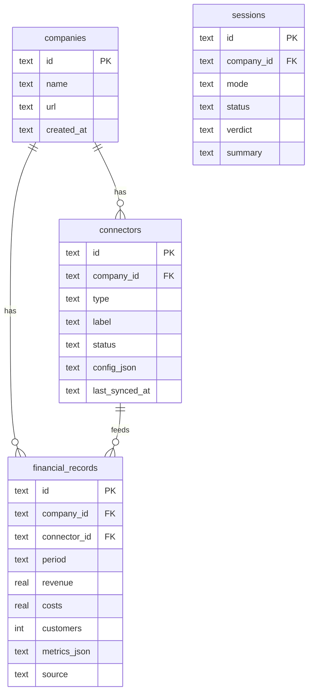

# 🗄️ DB & Connectors

> Companion to [frontend-spec.md](frontend-spec.md) and [future-scope.md](future-scope.md)'s "Data connections" phase. This is the durable layer underneath the Courtroom: companies, what data sources they've linked, and the financial/growth records those sources feed in over time — so a court session can draw on more than one conversation's worth of evidence.

## Why SQLite now, not the Postgres on port 27972

A local **PostgreSQL 18** is already installed and pre-configured for port 27972 (`C:\Program Files\PostgreSQL\18\data\postgresql.conf`) — that's almost certainly why that port number came up. It's stopped and password-protected (`scram-sha-256` on all connections, including loopback), so starting it and creating a role needs either your postgres superuser password or an elevated `Start-Service`, neither of which I'll do without you in the loop.

For right now: **SQLite** (`backend/data/necromancer.db`, already gitignored next to the Chroma vector store). No service, no password, no admin rights, nothing to start — `backend/app/services/db.py` opens the file directly. It's genuinely enough for a single-process hackathon backend; the only reason to move is concurrent writers from multiple processes.

**Moving to Postgres later, when you want to:**
```sql
-- run once, in psql or pgAdmin, with your postgres superuser password:
CREATE ROLE necromancer LOGIN PASSWORD 'pick-one';
CREATE DATABASE necromancer OWNER necromancer;
```
Then point the backend at it (new `DATABASE_URL` setting, swap `sqlite3` calls in `db.py` for `asyncpg`/`psycopg` — the function signatures in `db.py` don't need to change, only their bodies).

---

## Schema



- **`companies`** — one row per business being analyzed, whether it's alive (Grow/Rescue), new (Launch), or dead (Revive).
- **`connectors`** — what data sources a company has linked. `type` is one of `CONNECTOR_TYPES` in `db.py`; `status` is `active` or `coming_soon` (see below). `config_json` holds connector-specific settings (e.g. a Tally company file path, once that type is real).
- **`financial_records`** — one row per period (e.g. `"2026-09"`) per company: revenue, costs, customers, plus a free-form `metrics_json` for anything mode-specific. This is the "continuously updated" data the question asked about: every sync (manual today, automatic later) adds rows instead of overwriting a single snapshot, so growth over time is queryable.
- **`sessions`** — durable history of court sessions (status/verdict/summary), written once a session finishes or errors. Live session state during a run still lives in `app/state.py`'s in-memory dict for low-latency SSE; this table is what survives a backend restart, and what `GET /api/session/{id}` falls back to when the process restarted.

---

## What a company can give — connector types

| Type | Status | What it needs |
|---|---|---|
| `manual` | ✅ **active today** | A `POST .../financial-records` call — the number you type in, or a CSV parsed client-side and posted row by row (matches `flow.md`'s "CSV read by code, not the AI" rule) |
| `bank_statement` | 🚧 coming soon | Statement upload + parsing |
| `upi` | 🚧 coming soon | UPI/payment gateway API + OAuth |
| `pos` | 🚧 coming soon | POS vendor API |
| `tally` | 🚧 coming soon | Tally export/API integration |
| `gst` | 🚧 coming soon | GST portal API |
| `google_business_profile` | 🚧 coming soon | Google Business Profile API + OAuth |

Only `manual` actually ingests data right now — the others are registered (so the roadmap is visible in `GET /api/companies/{id}`) but return `status: "coming_soon"` and don't sync anything. This matches `future-scope.md` Phase 3 ("Data connections… with the owner's consent") being later work, not a hackathon-scope item: each of those needs a real API partnership or OAuth flow this project doesn't have yet. Building fake integrations for them would just be dead code.

---

## API

| Method | Path | Purpose |
|---|---|---|
| `POST` | `/api/companies` | `{name, url?}` → create a company |
| `GET` | `/api/companies/{id}` | Full picture: profile + connectors + financial_records |
| `POST` | `/api/companies/{id}/connectors` | `{type, label, config?}` → register a connector |
| `GET` | `/api/companies/{id}/connectors` | List a company's connectors |
| `POST` | `/api/companies/{id}/financial-records` | `{period, revenue?, costs?, customers?, metrics?, connector_id?}` → add/sync one period's numbers |
| `GET` | `/api/companies/{id}/financial-records` | List, ordered by period — feeds Rescue's "last 6–12 months" and Grow's trend charts |

---

## Not wired up yet

- `POST /api/revive` and `POST /api/problem` don't take a `company_id` yet — the Courtroom and the company/connector DB are two separate capabilities for this pass. The natural join: Revive could look up-or-create a company from the URL and attach `startup_data` as a `financial_records` row (or a dedicated `autopsy` table); Grow/Rescue could pull `financial_records` into the court's `context` instead of asking for numbers in a one-off intake question. Left out here because it changes the orchestrator and the request schemas (see `frontend-spec.md` §4), and this pass is scoped to the storage layer itself.
- No auth/ownership on companies — anyone with a `company_id` can read or write it. Fine for a local hackathon demo, not for anything shared.
