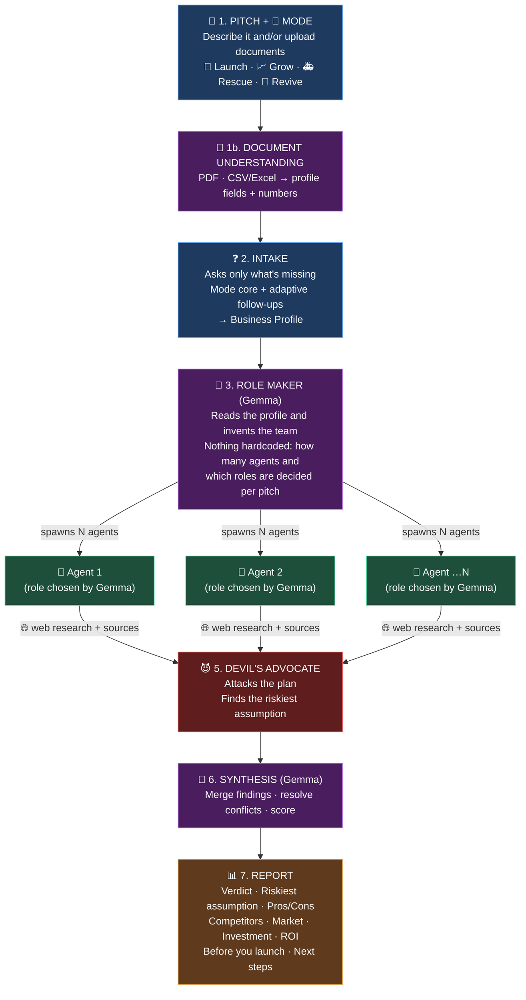
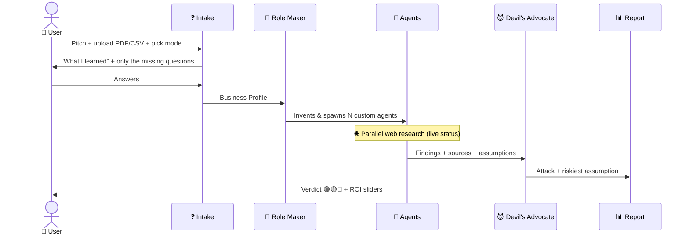

# 🧠 Startup Analyzer: Mixture of Agents (MoA)

> **"From idea to afterlife."** Starting, growing, struggling or dead: a custom team of AI agents tells you where you stand and what to do next.
>
> Pitch it or upload your documents → Gemma builds a custom team of AI agents → they research it live → you get a verdict.
> Pros/cons · Competitors · Market · Investment · ROI, all backed by sources.
>
> *"Every business dies on an assumption nobody tested. We find yours before you spend a rupee."*

📄 Screen-by-screen details, charts and the JSON the backend returns: [demo-spec.md](demo-spec.md)
🔄 **4 modes**, 🌱 Launch · 📈 Grow · 🚑 Rescue · 🧟 Revive, each with its own questions and signature section: [modes.md](modes.md)
🚀 **After the hackathon**: mobile app, WhatsApp, alerts, benchmarks, business model: [future-scope.md](future-scope.md)

---

## 🗺️ The flow at a glance



---

## 🪜 Step by step

| # | Step | What happens | What the user sees |
|---|---|---|---|
| 1 | 💬 **Pitch + mode** | User describes the business and/or uploads documents; AI preselects a mode | Text box · upload area · 4 mode cards |
| 1b | 📄 **Document understanding** | Uploaded files are turned into profile fields + monthly numbers | "📄 What I learned from your document" card |
| 2 | ❓ **Intake** | Asks only what's still missing: mode core + adaptive follow-ups | Question cards → editable profile card |
| 3 | 🧬 **Role Maker** | Gemma invents the team, nothing hardcoded | Agent cards appear one by one ✨ |
| 4 | 🌐 **Research** | Agents search the web in parallel and keep their sources | Live status per agent + live feed |
| 5 | 😈 **Devil's Advocate** | One call attacks the plan and finds the riskiest assumption | "Strongest argument against you" |
| 6 | 🔗 **Synthesis** | Gemma merges findings and scores the idea | "Merging findings…" |
| 7 | 📊 **Report** | The final analysis | Verdict + 11 sections + live ROI sliders |

### 1️⃣ Pitch
The user writes a paragraph: what the startup does and what they want to achieve.

> *"A subscription app that delivers home-cooked tiffin meals to students in Pune."*

They can also (or instead) **upload documents**: a company profile, a pitch deck PDF, a sales spreadsheet. The AI preselects one of the **4 mode cards** from the pitch or the document; the user confirms with one click.

### 1️⃣b Document understanding
Turns whatever the user uploaded into facts the AI can use, **before** any question is asked.

1. **Extract**: read the content (see table below)
2. **Understand**: one Gemma call maps it to Business Profile fields + a short summary + a suggested mode
3. **Confirm**: the user sees what was learned and fixes anything wrong
   ```
   📄 From "CompanyProfile.pdf" I learned:
   ✓ Mobile phone retail · 2 shops, Pune          (p.1)
   ✓ Revenue: ₹18L/mo (2024) → ₹9L/mo (now)       (p.1)
   ✓ Brands: Xiaomi, Samsung, Realme             (p.1)
   ? Cash in bank: not found
   → Suggested mode: 🚑 Rescue                    [Edit] [Looks right →]
   ```
4. **Intake skips** everything already found; adaptive follow-ups dig into the document (*"Your profile says you opened a 3rd shop in March. Is that when sales dropped?"*)
5. **Agents get the document summary** as context, so research starts from facts

| File | How we read it | Priority |
|---|---|---|
| **PDF** (profile, pitch deck) | Sent straight to the model (fallback: extract the text with `pypdf`) | 🟥 Must |
| **CSV / Excel** (monthly numbers) | Read by **plain code, not the AI**, because numbers must be exact; feeds the Grow/Rescue charts directly | 🟥 Must |
| **Images** (dashboard screenshot, ledger photo) | The model reads images | 🟨 Should |
| **DOCX / PPTX** | Text extraction library, or ask for a PDF export | 🟦 Stretch |

**Rules:**
- 🔒 Files are processed in memory and **never stored**; the screen says so
- 🛡️ Document text is treated as **data, never instructions** (a document saying "ignore previous instructions" is ignored)
- 🔢 Numbers read from a PDF are marked **"from document, please check"**; numbers from CSV are exact
- 📏 Limits: 3 files · 10 pages · 5 MB each · 1 AI call per document
- ⚠️ We haven't yet checked whether Gemma accepts PDFs through the API; test it in the first 30 minutes together with web search

### 2️⃣ Intake: ask before researching
The user picks one of **4 mode cards** (the AI preselects one from the pitch). The questions then depend on the mode:
- **Mode core questions** (fixed, ~6): the numbers the charts and ROI need
- **Adaptive follow-ups** (AI-generated, max 4): guided by the mode's **playbook**, each showing *why* it's asked

| Mode | Core questions focus on | Adaptive follow-ups dig for |
|---|---|---|
| 🌱 Launch | Budget · market · team · price | Is the idea real? (customer, proof of payment, advantage) |
| 📈 Grow | Current revenue · customers · channels | Where's the bottleneck? (concentration, capacity, best segment) |
| 🚑 Rescue | **Last 6–12 months of numbers** · when the decline started | Where exactly is it breaking? (footfall vs. conversion, which segment, what changed) |
| 🧟 Revive | History · peak · why it died · assets left | Was the cause of death fixable? (what changed since, would customers return) |

Full question lists and playbooks: [modes.md](modes.md)

**Output →** `Business Profile` (JSON, includes `mode` and `document_context`)

### 3️⃣ Role Maker: builds a different team for every pitch ⭐
Gemma reads the Business Profile and **decides on its own** how many agents to create, what each one is called, what it researches and how it behaves. **No agent is hardcoded.**

The only fixed rule: every report section (Pros/Cons, Competitors, Market, Investment, ROI) must be covered by at least one agent. *How* to cover them is Gemma's choice.

**Same flow, different teams. Example teams Gemma might create:**

| Pitch | Team Gemma might spawn |
|---|---|
| 🍱 Tiffin delivery in Pune | Local Food Market Analyst · Delivery Logistics Expert · Student Pricing Analyst · FSSAI Compliance Checker |
| 💳 BNPL app for students | Credit Risk Analyst · RBI Lending Compliance Officer · Fintech Competitor Scout · Unit Economics Modeller |
| 🏋️ Gym chain in Tier-2 cities | Real Estate & Location Scout · Fitness Market Analyst · Capex & Break-even Planner |

**Output →** `Agent Manifest`: name, role, mission and system prompt for each agent · 🎬 *Demo moment: the agent cards appear live, and the team is different every time*

### 4️⃣ Research: agents run in parallel
Each agent searches the web for its own task, **keeps every source link**, and reports to a shared board.
Every agent follows the same **thinking checklist** in its JSON output: core assumption → evidence for and against → risks tagged 🌍 External / 🏠 Internal / 🧪 Assumption → countermeasures (details: [modes.md](modes.md#-how-every-agent-thinks-shared-checklist)).

> 🔄 *Delivery Logistics Expert: found 6 rivals…* · *Student Pricing Analyst: reading 4 reports…* · *FSSAI Compliance Checker: checking licences…*

### 5️⃣ Devil's Advocate 😈
One Gemma call reads all the findings and **tries to kill the business case**. The attack depends on the mode:

| Mode | The attack |
|---|---|
| 🌱 Launch | ☠️ **Pre-mortem:** *"It's 12 months from now and you're dead. Why?"* |
| 📈 Grow | 🛡️ **Red team:** *"If I were a new entrant, how would I destroy you?"* + the wrapper trap: *"What if a big platform ships this for free?"* |
| 🚑 Rescue | *"Why will the turnaround fail too?"* |
| 🧟 Revive | *"Why will it die a second time?"* |

It then:
- Writes the **strongest argument against** the idea
- Picks the **riskiest assumption** from the agents' `core_assumption`s
- Says whether the plan **survives** the attack

This is a fixed step after research, so the Role Maker still decides the research team freely.

### 6️⃣ Synthesis
Gemma merges all findings and the devil's advocate attack, resolves contradictions, scores each dimension and writes the verdict.

### 7️⃣ Report: the output
The agents change every time, but **the report always has the same sections**. Synthesis maps whatever the agents found onto them.

| | Section | What it shows |
|---|---|---|
| 🎯 | **Verdict** | 🟢 GO / 🟡 PIVOT / 🔴 NO-GO · viability score 0–100 · top 3 reasons |
| 🧪 | **Riskiest assumption** | *"Your plan assumes students will pay ₹2,500/mo. Test this first."* + how to test it cheaply |
| 😈 | **Strongest argument against you** | The devil's advocate attack, and whether the plan survives it |
| 📐 | **Score breakdown** | 6 dimensions, 0–10 each |
| ✅❌ | **Pros / Cons** | Strengths & weaknesses for this user's situation, with impact and sources |
| ⚔️ | **Competitors** | Table: name · what they do · pricing · funding · how you differ |
| 📈 | **Market Analysis** | Market size (total / reachable / winnable) · target customer · trends · sources |
| 💰 | **Investment** | Startup cost · monthly burn · how long the budget lasts · funding route |
| 📉 | **ROI** | 24-month projection · 3 scenarios · break-even · **LTV:CAC** · live sliders |
| 📋 | **Before you launch** | Licences, registrations and approvals needed (FSSAI, GST, RBI…) |
| 🚀 | **Next steps** | 30/60/90 day plan: day 1 starts with testing the riskiest assumption |
| 🔗 | **Sources** | Every link, grouped by agent |

---

## 🎯 Numbers rules (how we stay credible)

> [!IMPORTANT]
> Judges will push hardest on ROI. An AI inventing a single "240% ROI" number won't hold up.

1. **🧮 Code does the maths, not the AI.** Gemma estimates the *assumptions*; plain code calculates break-even, ROI and LTV:CAC.
2. **👀 Show the assumptions:** *"Assumed: ₹500/mo price · 2% conversion · ₹3L/mo burn"*, each marked "from you", "from research 🔗" or "AI estimate".
3. **🎚️ Make them editable sliders** so the verdict updates live in the browser.
4. **📏 Give ranges, not one number:** *"ROI 18–35% by year 2 · break-even month 14–20"*
5. **🚫 No uncited statistics** in the product or the pitch. If we can't link it, we don't say it.

---

## 🔑 API keys: 3 accounts, 3 quotas

- **3 Gemini API keys from 3 different accounts** = ~3× the free-tier quota. Keys from the same project share one quota and don't help.
- Calls **rotate across keys**; a rate-limit error (429) moves the call to the next key.
- 🛡️ **Keep one key untouched during the build** so its daily quota is full for judging.
- Budget per run: ~8–12 calls (documents 1 each · mode preselect 1 · follow-ups ≤4 · Role Maker 1 · agents N · devil's advocate 1 · synthesis 1).

---

## 🎬 Demo script (3 min)



**3 minutes, 4 modes: one live, three replayed**

| Time | What |
|---|---|
| 0:00–0:15 | Hook: *"From idea to afterlife."* Show the 4 mode cards |
| 0:15–1:50 | **🚑 Rescue LIVE**: drop the phone shop PDF + CSV → profile fills itself → 1–2 adaptive questions → team invented → research → *"Where you're failing"* chart + ☝️ the ONE thing → drag the EMI slider |
| 1:50–2:10 | **🌱 Launch** (saved run, or a judge's idea live if time allows): pre-mortem + riskiest assumption |
| 2:10–2:30 | **📈 Grow** (saved run): 🛡️ *"How a new entrant would destroy you"* |
| 2:30–2:45 | **🧟 Revive** (saved run): ⚰️ autopsy + *"what's different now"* |
| 2:45–3:00 | *"Same pipeline, 4 situations, a different team every time."* Close |

**The moments judges remember:**
1. 📄 **Drop a PDF and the profile fills itself in**
2. ✨ **The team is invented live:** a different team for every situation
3. 🧪 **"Your riskiest assumption is…"** / ☝️ **"The ONE thing"**
4. 🎚️ **Drag the slider:** the verdict changes colour

---

## 👥 Team split (6 hours)

| Hour | 🤖 A: AI / Backend | 🔎 B: Agents / Data | 🎨 C: Frontend |
|---|---|---|---|
| **0:00–0:30** | 🤝 **All:** agree JSON shapes · repo · test all 3 keys + web search + PDF input | | |
| **0:30–2:00** | Document understanding + intake (`next_question`, all 4 playbooks) | One generic agent runner (any role, with web search) + key rotation · write the 4 sample PDFs + 2 CSVs | Pitch box + upload + mode cards + intake UI (on fake data) |
| **2:00–3:30** | Role Maker + devil's advocate (4 attack variants) + synthesis | ROI + LTV:CAC maths · CSV → monthly table | Agent cards + live status · shared report sections |
| **3:30–4:30** | Connect everything end to end | Run all 4 sample companies, **save each run** as fallback | 4 signature sections (where you're failing · threats · autopsy · riskiest assumption) + sliders |
| **4:30–5:15** | 🧊 **Feature freeze:** bug fixes only | Devpost write-up + backup video | Polish UI |
| **5:15–6:00** | 🎤 **All:** rehearse the demo ×2 · submit early | | |

---

## ⚖️ Implications

### ✅ What we gain
- **Not another chatbot.** Dynamic agents + cited sources + maths done in code beat "ask ChatGPT about my startup".
- **Works at every stage.** New idea, growing, declining or dead: one pipeline, 4 modes.
- **Starts from real facts.** Uploaded documents and numbers mean less typing and sharper questions.
- **Credible numbers.** The AI only estimates assumptions; code does the maths; every number shows where it came from.

### ⚠️ What it costs and risks

| Choice | Implication | How we handle it |
|---|---|---|
| **Dynamic agents** | Gemma may create a strange or overlapping team | Every report section must be covered; fallback team if the output is invalid |
| **Live web search** | 30–90s wait, can fail; we haven't yet checked whether Gemma's web search works through the API | Live status screen covers the wait; run `check_search.py` first; Gemini as backup |
| **Parallel agents** | ~6–8 API calls per run | 3 keys from different accounts + key rotation + demo key kept untouched |
| **AI-estimated market & finance numbers** | Can be wrong; judges push hardest on ROI | Show assumptions + sources, ranges not single numbers, sliders let the user correct them |
| **All 4 modes first-class** | 4 playbooks, 4 attacks, 4 signature sections, 4 samples: the biggest scope risk | Shared pipeline keeps it to prompt variants + 4 components; cut order in [modes.md](modes.md#️-if-we-fall-behind-cut-in-this-order) |
| **Document upload** | Misread numbers, private data, hidden instructions in a file | User confirms the "What I learned" card · CSV read by code · never stored · document text treated as data |
| **Big report (12 sections)** | Too much for 6h × 3 people | Strict priorities. If behind, cut first: competitor scatter → market growth chart → risk matrix |
| **Live demo** | Wi-Fi or API fails during judging | **Saved run for every mode**, replayed with the same animations |

---

## ❓ Open decisions

- [ ] **Web search model:** does Gemma search work through the API? (run `backend/check_search.py`). If not, use Gemini for research and Gemma for everything else.
- [ ] **Scope:** any startup (better demo) or fintech only (sharper compliance angle)?
- [ ] **PDF input:** does Gemma accept PDFs through the API? If not, `pypdf` text extraction or Gemini for this one step.
- [x] **All 4 modes first-class**, each with a demo sample + saved run
- [x] **4 mode cards + AI preselect**
- [x] **Document upload** (PDF + CSV/Excel must; images should; DOCX/PPTX stretch)
- [x] **Mode 2** = 📈 Grow + 🛡️ Threats · **Mode 4** = owner revives their own company (see [modes.md](modes.md))
- [ ] **Project name** 🏷️
