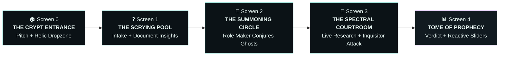

# 💀 Project Necromancer: Cyber-Necromantic Frontend Specification & UI/UX Master Plan

> **"From Idea to Afterlife."**
> *We don’t just evaluate businesses. We summon an Army of Ghost Agents from the digital graveyard to dissect assumptions, attack weaknesses, and resurrect viable enterprises.*
>
> **Domain:** Multi-Agent Business Analyzer & Reanimation Engine
> **Visual Identity:** Spooky Cyber-Necromancy · Ethereal Phantom Glows · Occult-Tech Terminal · Spectral Deliberation Chamber
> **Status:** Authoritative Specification & Developer Source of Truth

---

## 🧭 Executive Summary & Core Identity

**Project Necromancer** is an agentic AI operating platform that diagnoses, stress-tests, and resurrects businesses at every stage of their lifecycle. Unlike conventional, sterile business dashboards, Necromancer wraps industrial-grade financial modeling and live multi-agent intelligence in a **compelling cyber-necromantic aesthetic**:

- **The Problem:** 42% of startups and small businesses die because of "Assumption Debt" — fatal beliefs that were never tested before capital was incinerated.
- **The Solution:** A user provides a pitch or drops documents (pitch deck, PDF profile, CSV sales ledger, or dead startup URL). The **Role Maker** summons a custom **Army of Ghost Agents** (specialists conjured specifically for that pitch). They scry the live web, present evidence in a **Spectral Courtroom**, face an adversarial attack from the **Grand Inquisitor (Devil's Advocate)**, and deliver an interactive **Tome of Prophecy (Executive Intelligence Report)** with real-time reactive financial levers.
- **The Core Rule:** *Plain code calculates the math; AI estimates the assumptions; live sources back every claim.*

---

## 🔮 The 4 Reanimation Modes

The user selects where they stand on the **Company Lifeline Curve**, or the AI auto-preselects it from their pitch or ingested documents:

```
                  📈 GROW [Peak & Expansion]
                 .-'""'-.
               .'        '.
  🌱 LAUNCH   /            \   🚑 RESCUE [Decline & Hemorrhage]
  [Inception]               '.
                              \
                               '--.________/\___/\____ ⚰️ SHUT DOWN
                                                      \
                                                       \___ 🧟 REVIVE
                                                            [Reanimation]
```

| Mode | Necromantic Theme | The User's Plight | The Core Inquiry | Signature Weapon / Section | Possible Verdicts |
| :--- | :--- | :--- | :--- | :--- | :--- |
| 🌱 **Launch** | **The Genesis Ritual** | *"I have an idea / plan to build X."* | Should this entity be granted life? | 🧪 **Riskiest Assumption Curse & Pre-Mortem** | 🟢 **GO** · 🟡 **PIVOT** · 🔴 **NO-GO** |
| 📈 **Grow** | **The Blood Pact** | *"My company functions, make it stronger."* | Where can it expand, and what shadows threaten it? | 🛡️ **Red-Team Inquisitor Attack & Platform Wrapper Trap** | 🟢 **TOP LEVERS** · 🔵 **GROWTH SCORE** · 🔴 **THREAT ALERT** |
| 🚑 **Rescue** | **The Emergency Exorcism** | *"My numbers are bleeding out."* | Why is the life-force draining, and how do we stop it? | 📉 **12-Month Flatline Timeline & ☝️ The ONE Ritual** | 🟢 **RECOVERABLE** · 🟡 **RESTRUCTURE** · 🔴 **WIND DOWN** |
| 🧟 **Revive** | **Digital Necromancy** | *"My business died, I want to reanimate it."* | Why did it perish, and what changed in the mortal realm? | ⚰️ **Digital Autopsy & Ghostly Asset Inventory** | 🟢 **REANIMATE** · 🟡 **PIVOT REVIVAL** · 🔴 **STAY DEAD** |

---

## 🎨 Spooky Cyber-Necromancy Design System

The visual design must immediately mesmerize the user. It fuses **dark gothic mysticism** with **high-tech terminal precision**: deep obsidian voids, glowing ectoplasmic cyan/emerald accents, spectral card levitation, subtle runic borders, and flickering CRT scanline effects.

### 1. Typography Matrix
- **Headings & Sigils:** `Bricolage Grotesque` or `Cinzel Decorative` (bold, atmospheric, authoritative)
- **Body & Dialogue:** `IBM Plex Sans` (clean, high-legibility editorial sans-serif)
- **Data, KPIs & Terminal Logs:** `IBM Plex Mono` / `JetBrains Mono` (tabular figures, code-like veracity)

### 2. Spectral Color Palette (HSL & HEX Tokens)

```css
:root {
  /* The Void (Surfaces & Backgrounds) */
  --void-deep: #05080A;          /* Deepest crypt void */
  --void-surface: #0B1216;       /* Obsidian slate container */
  --void-elevated: #111A20;      /* Hover / modal surface */
  --void-line: #1C2B34;          /* Runic boundary borders */
  --void-glow: rgba(20, 184, 166, 0.12);

  /* Ectoplasmic Typography */
  --ghost-ink: #E6F4F1;          /* Pure spectral text */
  --ghost-muted: #78929E;        /* Whispering secondary text */
  --ghost-faint: #3F5763;        /* Subdued borders / tags */

  /* The 4 Mode Auras */
  --aura-launch: #10B981;        /* Phantom Emerald (Life/Birth) */
  --aura-grow: #3B82F6;          /* Spectral Cobalt (Energy/Power) */
  --aura-rescue: #F59E0B;        /* Alchemical Amber (Danger/Failing) */
  --aura-revive: #A855F7;        /* Necromantic Violet (Reanimation) */

  /* Adversarial & Verdict Accents */
  --blood-verdict: #EF4444;      /* Inquisitor / No-Go / Death */
  --blood-glow: rgba(239, 68, 68, 0.25);
  --sacred-gold: #EAB308;        /* Pivot / Warning */
  --ectoplasm-cyan: #14B8A6;     /* Primary interactive accent */
}
```

### 3. Atmospheric Visual Effects
- **Ectoplasmic Glow:** `box-shadow: 0 0 20px -3px var(--mode-aura, var(--ectoplasm-cyan))` on active cards.
- **Runic Border Gradients:** `border-image: linear-gradient(135deg, var(--void-line), var(--mode-aura), var(--void-line)) 1`.
- **Spectral Pulse Animation:** Ghost agent cards softly breathe with a 3-second keyframe opacity & box-shadow pulse while researching.
- **Audio Atmosphere Toggle:** Optional ambient spooky drone or subtle clicks upon ghost summons (Web Audio API synth or audio toggle, muted by default).

---

## 🗺️ The 5 Interactive Screens & User Flow



---

### 🏠 Screen 0: The Crypt Entrance (Pitch & Ingestion Hub)

The landing sanctuary where users present their business proposition or exhume a digital corpse.

```
┌────────────────────────────────────────────────────────────────────────┐
│  💀  PROJECT NECROMANCER                    [ 🔈 Ambient: Muted ] [ 🌓 ]│
│  "Y Combinator for the Afterlife • From Idea to Reanimation"           │
│                                                                        │
│  ┌──────────────────────────────────────────────────────────────────┐  │
│  │ 💬 Present your business or summon a deceased startup...         │  │
│  │ "A tiffin meal subscription for students in Pune with 3 dark     │  │
│  │  kitchens, or https://shyp.com to exhume why it collapsed..."    │  │
│  └──────────────────────────────────────────────────────────────────┘  │
│                                                                        │
│  ┌ - - - - - - - - - - - - - - - - - - - - - - - - - - - - - - - - ┐  │
│  │  📜 DEPOSIT SACRED RELICS (Drop Files Here)                      │  │
│  │  PDF Pitch Deck • CSV Financial Ledger • Balance Sheet Image    │  │
│  │  🔒 Read strictly in ephemeral memory — never damned to disk    │  │
│  └ - - - - - - - - - - - - - - - - - - - - - - - - - - - - - - - - ┘  │
│                                                                        │
│  THE LIFELINE CURVE — Select Your Spiritual Stage:                     │
│  [ ~~~ Idea ~~~ Peak ~~~~~ Decline ~~~~~ Dead ~~~~~ Reborn ~~~ ]       │
│  ┌────────────┐  ┌────────────┐  ┌────────────┐  ┌────────────┐        │
│  │ 🌱 LAUNCH  │  │ 📈 GROW    │  │ 🚑 RESCUE  │  │ 🧟 REVIVE  │        │
│  │ Inception  │  │ Scaled     │  │ Bleeding   │  │ Exhumation │        │
│  │ Aura: Jade │  │ Aura: Blue │  │ Aura: Amber│  │ Aura: Purple│       │
│  └────────────┘  └────────────┘  └────────────┘  └────────────┘        │
│   ✨ AI Auto-Aura: "Sales are declining detected — 🚑 Rescue preselected"│
│                                                                        │
│  ⚡ Quick-Summon Sanctuaries (Demo Replays):                           │
│  [🍱 Pune Tiffin]  [📱 Phone Shop Crypt]  [📚 Coaching Co]  [🛒 Grocery] │
│                                                                        │
│                   [ 🔮 SUMMON GHOST SQUAD → ]                          │
└────────────────────────────────────────────────────────────────────────┘
```

#### UI Elements & Interactions
1. **Interactive SVG Lifeline Curve:** A smooth wave showing the 5 stages of business mortality. Hovering or clicking a point switches the active mode.
2. **4 Mode Sigil Cards:** Glowing cards featuring icon, title, description, and dynamic aura outline. The AI auto-detects mode from user input in real-time.
3. **Relic Dropzone:** Handles Drag & Drop for `.pdf`, `.csv`, `.xlsx`, `.png`, `.jpg`. Displays uploaded file chip with file size and relic type badge.
4. **Validation Guard:** Requires either ≥ 20 characters in text prompt OR at least 1 uploaded document.
5. **Quick-Summon Demo Chips:** Instant pre-population of full demo runs (Pune Tiffin, Phone Shop, Coaching Co, Grocery Revenant) with 100% offline fallback reliability.

---

### ❓ Screen 1: The Scrying Pool (Intake & Relic Extraction)

The phase where document facts are verified and missing business parameters are questioned.

#### 1. "What the Spirits Extracted" Card
When files are dropped, this card sits at the top before any question is asked:
```
┌────────────────────────────────────────────────────────────────────────┐
│  📜 WHAT THE SPIRITS EXTRACTED FROM "Ledger.csv" & "Deck.pdf"          │
│                                                                        │
│  ✓ Sector: Consumer Hardware Retail (2 Shops, Pune)         [Deck p.1]  │
│  ✓ 12-Month Revenue Bleed: ₹18L/mo ➔ ₹9L/mo       [Ledger.csv • EXACT] │
│  ⚠ Headcount: 6 Ghost Staff           [Deck p.2 • AI Estimated, Check] │
│  ? Cash Runway / Treasury: Not Found in Relics                         │
│                                                                        │
│  Spiritual Stage Confirmed: 🚑 RESCUE       [ ✏️ Edit ]  [ Verified → ] │
└────────────────────────────────────────────────────────────────────────┘
```
- **Source Badges:** Color-coded verification tags (`[CSV • EXACT]`, `[Deck p.1]`, `[Unverified ?]`).
- **Skip Logic:** Any field already verified is omitted from the intake questionnaire.

#### 2. Adaptive Seance Questionnaire
Step-by-step interactive questionnaire (progress bar styled as an alchemical gauge `3/6`):
- **Core Numbers Inputs:** Starting Budget / Treasury, Target Market, Current Burn, Team Composition chips.
- **Adaptive Probing Questions (Max 4):**
  - Generated live by Gemma based on the mode playbook.
  - Every question displays an atmospheric **"Why the Spirits Ask This"** badge (e.g. *"Asking because sudden footfall drops usually point to predatory rival pricing."*).
  - Quick-pick option pills + freeform write-in input.

#### 3. Assembled Business Grimoire Card
A glowing summary badge of the confirmed parameters with a prominent CTA:
`[ 🔮 BEGIN NECROMANTIC RESEARCH → ]`

---

### 🧬 Screen 2: The Summoning Circle (Role Maker Team Assembly)

The first **WOW moment** of the demo. Gemma's Role Maker analyzes the Grimoire and **invents a unique team of Ghost Agents live**.

```
┌────────────────────────────────────────────────────────────────────────┐
│  🧬 GEMMA IS SUMMONING THE GHOST SPECIALISTS...                       │
│                                                                        │
│  "Offline electronics retail + footfall drop + Pune competition ➔      │
│   I am summoning the Rivals Scout, EMI Inquisitor, and Forensic Auditor"│
│                                                                        │
│  ┌──────────────────┐  ┌──────────────────┐  ┌──────────────────┐      │
│  │ 🏪 GHOST SCOUT   │  │ 💳 EMI INQUISITOR│  │ 📊 FORENSIC AUDIT│ ...  │
│  │ Local Retail     │  │ Consumer Finance │  │ Sales Decay      │      │
│  │ Competition      │  │ Analyst          │  │ Investigator     │      │
│  │ ──────────────── │  │ ──────────────── │  │ ──────────────── │      │
│  │ Mission: Track   │  │ Mission: Uncover │  │ Mission: Dissect │      │
│  │ predatory rivals │  │ financing traps  │  │ revenue bleeding │      │
│  │ Feeds: ⚔️ Rivals │  │ Feeds: 💰 Treasury│  │ Feeds: 📉 Decay  │      │
│  └──────────────────┘  └──────────────────┘  └──────────────────┘      │
└────────────────────────────────────────────────────────────────────────┘
```

#### Ghost Agent Card Specifications
- **Spectral Emergence Animation:** Cards materialize sequentially with an ethereal rise-and-fade keyframe (`animation: riseGlow 0.4s ease both`).
- **Ghost Avatar & Title:** Specific spectral icon (🏪, 💳, 📊, 🛡️, ⚖️), Custom Ghost Name, and Specialization.
- **Mission Statement:** 1-sentence description of the agent's objective.
- **Target Feeds:** Badges showing which report sections this agent informs (⚔️ Rivals, 📈 Demand, 💰 Treasury, 📉 Decay).

---

### 🔄 Screen 3: The Spectral Courtroom & Deliberation Chamber

The ghosts search the web in parallel, deposit evidence onto the Blackboard, and endure the Grand Inquisitor's trial.

```
┌────────────────────────────────────────────────────────────────────────┐
│  🔄 DELIBERATION IN PROGRESS • 3 of 4 Ghosts Ready        [ ██████░░ 75% ]│
│                                                                        │
│  🏪 Ghost Scout      ✅ Ready    • 8 Web Artifacts Scried              │
│  💳 EMI Inquisitor   🔍 Scrying  "bajaj finserv retail dealer margins" │
│  📊 Forensic Auditor 🧠 Modeling "margin decay across 10k-25k bracket" │
│  🛡️ Regulatory Lich  ✅ Ready    • 4 Compliance Edicts Located         │
│                                                                        │
│  ┌─ 📜 Live Ethereal Stream (SSE Feed) ──────────────────────────────┐ │
│  │ 13:08:12 🏪 Discovered chain store opened 1.2km away with 0% EMI  │ │
│  │ 13:08:16 📊 Sales in ₹10k-₹25k tier plummeted 62%; premium steady │ │
│  │ 13:08:21 💳 Single-bank financing eliminates 55% of walk-in buyers│ │
│  └───────────────────────────────────────────────────────────────────┘ │
│                                                                        │
│  ┌─ 😈 THE GRAND INQUISITOR'S ADVERSARIAL ASSAULT ──────────────────┐ │
│  │  "You cannot outprice a venture-backed chain store or Amazon.    │ │
│  │   Blanket discounts are burning your remaining ₹12L runway.      │ │
│  │   Turnaround survives ONLY IF you restructure to multi-bank EMI."│ │
│  └──────────────────────────────────────────────────────────────────┘ │
│                                                                        │
│                 [ 🔗 Gemma is synthesizing final prophecy... ]         │
└────────────────────────────────────────────────────────────────────────┘
```

#### Key Capabilities
- **Ghost Lifecycle State Machine:**
  `⏳ Summoned` ➔ `🔍 Scrying Web` ➔ `📖 Deciphering Sources` ➔ `🧠 Forensic Analysis` ➔ `✅ Verdict Ready` (with retry action on failure).
- **Live Terminal Log:** Monospace streaming output driven by Server-Sent Events (`agent_log`, `research`).
- **The Grand Inquisitor Assault Banner:** Distinct crimson-bordered challenge card showing the Devil's Advocate adversarial strike.
- **Seamless Transition:** Auto-scrolls into Screen 4 upon synthesis completion.

---

### 📊 Screen 4: The Tome of Prophecy (Executive Intelligence Report & Sandbox)

A single-page, high-density analytical dossier with a sticky spiritual navigation sidebar.

```
┌──────────────┬─────────────────────────────────────────────────────────┐
│ 🎯 Verdict   │  [ 74/100 ] 🟢 REANIMATION VIABLE (GO)                   │
│ 🧪 Curse     │  "Turnaround succeeds if mid-range phone buyer financing│
│ 😈 Inquisitor│   is unlocked. Premium margin walk-ins are healthy."    │
│ 📐 Hex-Scores│                                                         │
│ ⚖️ Pros/Cons │  ┌───────────────────────────────────────────────────┐  │
│ ⚔️ Rivals    │  │ 🧪 THE CURSED ASSUMPTION (Riskiest Belief)        │  │
│ 📈 Market    │  │ "That customers left because of price, not EMI."  │  │
│ 💰 Treasury  │  │ Cheap Exorcism: Sign 2 multi-bank EMI partners for│  │
│ 📉 Sandbox   │  │ 14 days; track walk-in conversion rate lift.      │  │
│ 📋 Sanctions │  └───────────────────────────────────────────────────┘  │
│ 🚀 Rituals   │                                                         │
│ 🔗 Citations │  (Detailed Analytical Sections Follow...)                │
└──────────────┴─────────────────────────────────────────────────────────┘
```

#### Detailed Section Breakdown

#### 4.1 🎯 Resurrection Verdict (Hero Dashboard)
- **Radial Necromantic Gauge:** Circular SVG gauge (0–100) rendered with dynamic glow:
  - 0–39: 🔴 **DOOMED / NO-GO**
  - 40–69: 🟡 **TRANSMUTE / PIVOT**
  - 70–100: 🟢 **REANIMATE / GO**
- **Confidence Rating:** High / Medium / Low backed by the tally of verified sources.
- **Top 3 Reasons:** Glowing bullet capsules.

#### 4.2 🧪 The Cursed Assumption (Riskiest Belief) & 😈 Inquisitor Verdict
- **The Fatal Assumption:** Extracted from the ghost findings.
- **Why It Threatens Mortality:** Exactly how the economic model breaks if false.
- **Cheap Exorcism Protocol:** A low-cost experiment to run before spending funds.
- **Pass/Fail Threshold:** Deterministic milestone.
- **The Inquisitor's Indictment:** Attack summary with the survival verdict badge:
  `✅ Survives` · `⚠️ Survives with Transmutation` · `❌ Perishes`.

#### 4.3 📐 Hexagonal Dimension Scores
Horizontal glowing bars with hover justification:
1. **Market Demand (25% weight)**
2. **Financial Viability / Runway (25% weight)**
3. **Competitive Moat (15% weight)**
4. **Execution Capacity (15% weight)**
5. **Regulatory Feasibility (10% weight)**
6. **Macro Timing (10% weight)**

#### 4.4 ⚖️ Spectral Pros & Cons (Impact Matrix)
Dual columns with impact badges (🔴 High, 🟡 Medium, 🟢 Low) and clickable source links for every statement.

#### 4.5 ⚔️ Rivals Arena & Constellation Map
- **Rivals Matrix:** Competitor name, core offering, pricing tier, war-chest funding, fatal vulnerability, and threat level.
- **Positioning Constellation (Scatter Plot):**
  - X-Axis: Price Tier (Accessible ➔ Premium)
  - Y-Axis: Market Dominance (Niche ➔ Monolithic)
  - Competitors mapped as ghost orbs; the user's venture rendered as a glowing pulsating star ⭐ highlighting uncontested market territory.

#### 4.6 📈 Market Domain Dimensions
- **TAM / SAM / SOM:** 3 concentric neon rings with rupee valuations and research citations.
- **Target Soul Persona:** Demographics, psychological pain point, and maximum willingness-to-pay threshold.

#### 4.7 💰 Treasury & Capital Burn
- **One-Time Reanimation Capex:** Bar breakdown (Licensing, Inventory, Initial Marketing, Tooling).
- **Monthly Burn:** Stacked breakdown (Rent, Salaries, Operations).
- **Runway Meter:** Visual countdown bar displaying remaining life expectancy in months.

---

### 📉 Section 4.8: The Reactive Alchemical Sandbox (WOW Moment #2)

An interactive 24-month projection widget. **Dragging any slider recalculates all metrics, curves, and verdict colors instantly in the browser without an AI API call.**

```
┌────────────────────────────────────────────────────────────────────────┐
│  📉 24-MONTH REANIMATION CASH FLOW & LTV:CAC SANDBOX                   │
│                                                                        │
│  [ Break-Even: Month 11 ] [ 24mo ROI: 182% ] [ LTV:CAC: 3.4× 🟢 ]       │
│                                                                        │
│  ┌── Interactive Levers ──────────┐  ┌── 24-Month Cumulative Cash ───┐│
│  │ Monthly Price (₹):      2,500 ━│  │ ₹L                            ││
│  │ New Souls / Mo:            65 ━│  │ 15┤               .---' 🟢 Opt││
│  │ Monthly Churn (%):       4.5% ━│  │  0┼───────★───────' 🟡 Base    ││
│  │ Monthly Fixed Burn:   ₹1.5L   ━│  │-15┤      Break-Even           ││
│  │ CAC (Acquisition Cost):₹1,200 ━│  │   └──────┬──────────── 🔴 Pess││
│  │ EMI Partners Added:         4 ━│  │         Mo 11         Mo 24   ││
│  └────────────────────────────────┘  └───────────────────────────────┘│
│                                                                        │
│  📜 Assumptions Ledger: Every parameter sourced from [Research 🔗]     │
└────────────────────────────────────────────────────────────────────────┘
```

#### Deterministic Math Engine (Executed in Pure JavaScript)
```javascript
// Pure client-side calculations — No hallucinated math
function calculateProjections(params) {
  const {
    startupCost,    // e.g. 800000
    price,          // e.g. 2500
    variableCost,   // e.g. 1600
    fixedBurn,      // e.g. 150000
    newPerMonth,    // e.g. 60
    growthRate,     // e.g. 0.05
    churnRate,      // e.g. 0.04
    cac             // e.g. 1200
  } = params;

  const marginPerUser = price - variableCost;
  const ltv = churnRate > 0 ? marginPerUser / churnRate : marginPerUser * 24;
  const ltvCacRatio = cac > 0 ? ltv / cac : 0;
  const cacPaybackMonths = marginPerUser > 0 ? cac / marginPerUser : 99;

  function runScenario(growthMultiplier) {
    let users = 0;
    let cumulativeCash = -startupCost;
    let breakEvenMonth = null;
    let points = [cumulativeCash];

    for (let m = 1; m <= 24; m++) {
      users = users * (1 + growthRate * growthMultiplier) * (1 - churnRate) + newPerMonth;
      const revenue = users * price;
      const totalCosts = fixedBurn + (users * variableCost);
      cumulativeCash += (revenue - totalCosts);
      points.push(cumulativeCash);

      if (breakEvenMonth === null && cumulativeCash >= 0) {
        breakEvenMonth = m;
      }
    }
    return {
      points,
      breakEvenMonth,
      finalCash: cumulativeCash,
      roi24: (cumulativeCash / startupCost)
    };
  }

  return {
    base: runScenario(1.0),
    pessimistic: runScenario(0.5),
    optimistic: runScenario(1.5),
    ltv,
    ltvCacRatio,
    cacPaybackMonths
  };
}
```

---

### 🌟 Mode Signature Sections

Each mode activates its own specialized signature component inside the report:

#### 1. 🌱 Launch: The Pre-Mortem & Riskiest Assumption
- **☠️ Pre-Mortem Narrative:** *"It is 12 months in the future, and your startup is dead. Here is the exact post-mortem of how Swiggy copied your student pricing and undercut your cloud kitchens."*
- **The Survival Protocol:** Immediate pivot steps required to prevent this demise.

#### 2. 📈 Grow: The Red-Team Inquisitor & Moat Check
- **Predatory Entrant Simulation:** *"How a well-capitalized competitor destroys your B2B contract within 90 days."*
- **Platform Wrapper Trap:** Evaluating if an upstream API or Big Tech vendor will ship this feature for free.
- **Moat Analysis:** Evaluating Brand, Switching Costs, Network Effects, and Proprietary Data.

#### 3. 🚑 Rescue: The 12-Month Flatline Timeline & ☝️ The ONE Ritual
- **12-Month Sales Decay Line Chart with Milestone Flags:**
  Shows the moment the business broke (e.g. `🚩 Feb: Rival Store Opens with 0% EMI`, `🚩 Mar: Premature discounting destroys margins`).
- **Ranked Afflictions Table:** Root causes ordered by percentage contribution to the decline.
- **☝️ The ONE Ritual:**
  - **ONE Customer Target:** Mid-range phone buyers (₹10k–₹25k)
  - **ONE Distribution Channel:** In-store physical multi-bank financing
  - **ONE Urgent Action This Week:** Sign 3 additional NBFC EMI integrations
  - **Immediate Pauses:** Terminate indiscriminate discounting immediately

#### 4. 🧟 Revive: The Digital Autopsy & Ghostly Relic Inventory
- **Cause of Death Forensic Card:** Real cause of death vs. the founder's original belief.
- **What Changed in the Mortal Realm:** Technological, regulatory, or consumer shifts that make reanimation viable today.
- **Recoverable Relics:** Reusable codebases, trademark authority, inactive customer email databases, or dormant regulatory licenses.

---

## ⚡ Technical Architecture & Component Tree

The frontend is built using **React 18 + Vite** (or Next.js App Router) with **Vanilla CSS / CSS Modules**, ensuring zero framework bloat and total control over animations and visual styling.

### Component Directory Tree
```
frontend/
├── public/
│   ├── favicon.svg
│   ├── sounds/                     # Subtle ambient sounds (optional)
│   └── samples/                    # Offline saved runs for the 4 modes
│       ├── launch_tiffin.json
│       ├── grow_coaching.json
│       ├── rescue_phoneshop.json
│       └── revive_grocery.json
├── src/
│   ├── assets/
│   │   └── sigils/                 # SVG sigils for the 4 modes
│   ├── components/
│   │   ├── layout/
│   │   │   ├── Header.jsx          # Title, ambient audio toggle, theme toggle
│   │   │   ├── Navigation.jsx      # Sticky dossier side-nav
│   │   │   └── Footer.jsx
│   │   ├── screen0_crypt/
│   │   │   ├── LifelineCurve.jsx   # Interactive SVG company lifeline
│   │   │   ├── ModeSelector.jsx    # 4 glowing mode cards
│   │   │   ├── RelicDropzone.jsx   # Drag & drop file ingestion
│   │   │   └── DemoChips.jsx       # 4 quick-launch fallback chips
│   │   ├── screen1_intake/
│   │   │   ├── ExtractedRelics.jsx # "What the spirits extracted" card
│   │   │   ├── IntakeStepper.jsx   # Questionnaire engine with progress bar
│   │   │   └── ProfileGrimoire.jsx # Confirmed business profile review card
│   │   ├── screen2_assembly/
│   │   │   ├── RoleMakerBanner.jsx # Gemma reasoning banner
│   │   │   └── GhostCard.jsx       # Animated dynamic agent cards
│   │   ├── screen3_courtroom/
│   │   │   ├── CourtroomStream.jsx # Real-time agent status tracker
│   │   │   ├── LiveFeedTerminal.jsx# SSE message ticker
│   │   │   └── InquisitorCard.jsx  # Red-team Devil's Advocate assault card
│   │   └── screen4_report/
│   │       ├── VerdictHero.jsx     # Radial gauge & verdict badges
│   │       ├── CursedAssumption.jsx# Riskiest assumption card
│   │       ├── ScoreBreakdown.jsx  # 6-dimension horizontal bar chart
│   │       ├── ProsConsMatrix.jsx  # Sourced strengths & weaknesses
│   │       ├── RivalsArena.jsx     # Competitors table & scatter plot
│   │       ├── MarketCircles.jsx   # TAM/SAM/SOM concentric circles
│   │       ├── TreasuryRunway.jsx  # Capex, opex & runway bar
│   │       ├── ReactiveSandbox.jsx # 24-Month line chart & instant sliders
│   │       ├── BeforeYouLaunch.jsx # Pre-requisites & licensing checklist
│   │       ├── ActionRoadmap.jsx   # 30/60/90-day execution plan
│   │       ├── CitationsCodex.jsx  # Grouped source links
│   │       └── signature/
│   │           ├── PreMortemCard.jsx       # Launch mode signature
│   │           ├── ThreatRadar.jsx         # Grow mode signature
│   │           ├── FlatlineTimeline.jsx    # Rescue mode signature
│   │           └── DigitalAutopsy.jsx      # Revive mode signature
│   ├── hooks/
│   │   ├── useSSEStream.js         # EventSource wrapper with reconnect
│   │   ├── useFinancialMath.js     # Deterministic slider projection math
│   │   └── useAmbientAudio.js      # Web Audio API ambient sound generator
│   ├── store/
│   │   └── sessionStore.js         # Reactive state (Zustand or Context)
│   ├── styles/
│   │   ├── index.css               # Reset, typography, design tokens
│   │   ├── necromancy.css          # Glows, keyframes, CRT scanlines
│   │   └── components.css          # Modular component styling
│   ├── App.jsx
│   └── main.jsx
├── package.json
└── vite.config.js
```

---

## 🔌 API Integration & SSE Protocol

The frontend communicates with the FastAPI backend through endpoints and a real-time Server-Sent Events stream:

### 1. Primary HTTP Endpoints
- `POST /api/problem`: Submits a pitch without uploaded files. Returns `{ session_id, stream_url }`.
- `POST /api/revive`: Submits a dead startup URL for scraping and exhumation. Returns `{ session_id, stream_url }`.
- `GET /api/stream/{session_id}`: Primary SSE stream for live updates.
- `GET /api/session/{session_id}`: Polling fallback returning persisted session data if SSE disconnects.
- `POST /api/companies`: Registers business profile in SQLite.
- `GET /api/companies/{id}/financial-records`: Retrieves historical records for Rescue/Grow modes.

### 2. SSE Event Stream Lifecycle

```
Client Connects ───▶ GET /api/stream/{session_id}
                          │
                          ├─▶ event: status       { "data": "routing" }
                          ├─▶ event: route        { "topic": "...", "complexity": "complex" }
                          ├─▶ event: research     [ { "query": "...", "chunks_stored": 8 } ]
                          ├─▶ event: role_making  { "data": "role_making" }
                          ├─▶ event: manifest     { "domain": "...", "agents": [ ... ] }
                          ├─▶ event: in_court     { "data": "in_court" }
                          ├─▶ event: rulings      { "attempt": 0, "rulings": { ... } }
                          ├─▶ event: verdict      { "data": "REANIMATE" }
                          ├─▶ event: summary      { "data": "..." }
                          └─▶ event: status       { "data": "done" }
```

### 3. Stage-Proof Fallback Strategy (Hackathon Reliability Guard)
In the event of network disruption or API rate limits on stage:
1. Every demo chip ([🍱 Pune Tiffin], [📱 Phone Shop], [📚 Coaching], [🛒 Grocery]) can toggle a **Replay Mode** loaded from `public/samples/*.json`.
2. The replay mode plays the exact same SSE sequence, animations, and ghost assembly with realistic millisecond timing delays.
3. This guarantees that **judges always experience a flawless, zero-latency live demonstration**.

---

## 🛠️ Step-by-Step Implementation Roadmap

| Phase | Focus Area | Deliverables |
| :--- | :--- | :--- |
| **Phase 1: Foundation & Theming** | Design Tokens & Layout | `index.css` & `necromancy.css` with dark obsidian palette, Bricolage & IBM fonts, SVG sigils, audio toggle, and header/footer. |
| **Phase 2: Screen 0 & Screen 1** | Ingestion & Intake Hub | Interactive Lifeline curve, 4 Mode Cards with auto-preselect, Relic Dropzone, "What the Spirits Extracted" card, and Intake Stepper. |
| **Phase 3: Screen 2 & Screen 3** | Ghost Assembly & Courtroom | Sequential card emergence animation for ghost specialists, SSE live feed terminal, status tracker, and Grand Inquisitor assault card. |
| **Phase 4: Screen 4 Core Report** | Executive Dossier | Radial Verdict gauge, Cursed Assumption callout, Score breakdown bars, Sourced Pros/Cons, Rivals arena, and Pre-requisites list. |
| **Phase 5: Reactive Sandbox** | Interactive Financial Sliders | Pure JavaScript projection engine, reactive 24-month SVG chart, dynamic LTV:CAC badges, and real-time verdict updating. |
| **Phase 6: 4 Signature Modes** | Stage Polish & Fallbacks | Pre-Mortem card (Launch), Red-Team radar (Grow), Flatline timeline + ONE thing (Rescue), Digital Autopsy (Revive), and 4 pre-recorded JSON demo replays. |

---

*This document serves as the immutable blueprint for the frontend implementation of Project Necromancer.*
