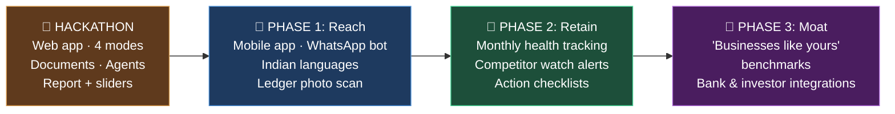

# 🚀 Future Scope: where this goes after the hackathon

> **Today:** a one-time AI analysis of your business.
> **Tomorrow:** an AI advisory team in every business owner's pocket. It reads their ledger, speaks their language, watches their market and warns them before things go wrong.

📄 Current product: [flow.md](flow.md) · [modes.md](modes.md) · [demo-spec.md](demo-spec.md)

---

## 🗺️ The roadmap at a glance



| Phase | Goal | Question it answers |
|---|---|---|
| 🏁 Hackathon | **Prove it works** | Can AI agents give a business a credible verdict? |
| 📱 Phase 1 | **Reach** small-business owners where they are | Can a shopkeeper with no laptop use it? |
| 🔁 Phase 2 | **Retain**: from one-time report to ongoing advisor | Why would they come back every month? |
| 🧠 Phase 3 | **Moat**: get better with every user | Why can't a competitor copy us? |

---

## 📱 Phase 1: Reach

### 📲 Mobile app
The website is for founders at a desk. **The app is for the owner in the shop.**

| Feature | Why it matters |
|---|---|
| 📸 **Snap your ledger** | Small businesses keep accounts on paper. Photo → AI reads the numbers → instant monthly table. No typing, no spreadsheets. |
| 🎙️ **Speak your problem** | *"Meri dukaan ki sale kam ho rahi hai"* ("my shop's sales are dropping"). Voice in, no long typing. |
| 📤 **Share to WhatsApp** | Send the report to a partner, investor, bank or family member who has a say in the business. |
| ⚡ **Decide on the spot** | *"Should I sign this EMI deal?"* Drag the slider in the shop and see the impact before signing. |

### 💬 WhatsApp bot
Same pipeline, **nothing to install**. Send a ledger photo or a voice note → get the verdict, the ONE thing and the report link back as WhatsApp messages.
> Small businesses in India already run on WhatsApp: orders, suppliers, customers. We meet them there.

### 🗣️ Indian languages
English · Hindi · Marathi · Tamil · Bengali… for both input (voice/text) and the report.
> *"Aapki sale isliye gir rahi hai: paas mein naya store khula hai."* ("Your sales are dropping because a new store opened nearby.")

### 🧒 Simple mode / investor mode
The same analysis in two languages of business:

| Simple mode (shop owner) | Investor mode (VC, bank) |
|---|---|
| *"You lose money on every new customer."* | *"LTV:CAC is 0.8; CAC payback exceeds customer lifetime."* |

---

## 🔁 Phase 2: Retain (from one-time report to ongoing advisor)

### 📈 Monthly health tracking
Re-run the analysis every month, automatically from new ledger photos or a connected account, and show the trend:
```
Health score   48 ──→ 61 ──→ 74   🟢
               Jun     Jul     Aug
               "EMI partners added"  "Accessories margin up"
```

### 🔔 Smart alerts
| Alert | Example |
|---|---|
| 📉 Sales dip | *"Sales dropped 12% this week. It's the mid-range segment again."* |
| 💸 Runway | *"At this burn, your cash lasts 5 months."* |
| 👀 **Competitor watch** | *"Chain store cut prices on ₹15–25k phones today."* |
| ⭐ Reviews | *"3 new reviews mention slow repairs."* |
| 🏛️ Schemes | *"A new state MSME subsidy opened. You qualify."* |

> 💡 The phone shop in our demo found out about the chain store **months too late**. Competitor watch fixes that.

### ✅ Action tracker
"The ONE thing" and the 30/60/90 plan become **tasks with due dates and reminders**. The next month's report checks: *did you do it, and did it work?*

### 💬 Talk to your agents (anytime)
Your agent team stays available. Ask the Competition Scout or the Finance Analyst a follow-up question any time, with full memory of your business.

### 🤔 Plain-language "what if"
*"What if I hire 2 more staff and open on Sundays?"* → the AI turns it into model changes → new projection.

---

## 🧠 Phase 3: Moat (gets better with every user)

### 📊 "Businesses like yours" benchmarks
Anonymous, aggregated comparisons from everyone using the product:
> *"Phone shops in Pune with 2 stores average a 14% margin. You're at 9%. The top 25% earn most of theirs from accessories and repairs."*

**This is the moat:** every new business makes the benchmarks better, and a newcomer can't copy that data.

### 🏦 Bank & lender integration
- One-click **loan application pack**: the report formatted for a bank or NBFC
- Lenders get a **structured, AI-checked view** of a small business that has no formal financials
- Owner shares it only with consent

### 💼 Investor & incubator integration
- **Launch mode → investor one-pager** in one click
- Incubators and accelerators screen applicant startups with a standard report
- VCs run **Grow/Rescue** on portfolio companies as an early-warning check

### 🏛️ Government scheme finder
A dedicated agent matches the business to schemes, subsidies and loans it qualifies for (MUDRA, Startup India, state MSME schemes…), with eligibility, documents needed and an application link.

### 🔌 Data connections
Instead of uploads: connect UPI / payment gateway, POS, Tally, GST returns, or Google Business Profile, with the owner's consent. Numbers update themselves.

---

## 💰 Business model

> All prices below are **starting hypotheses to test**, not validated numbers.

### Who pays

| Customer | What they get | How they pay |
|---|---|---|
| 🏪 **Small business owner** | Monthly health tracking, alerts, agents on call | Freemium subscription |
| 🚀 **Startup founder** | Launch analysis, investor one-pager | Free first report, pay per deep report |
| 🏦 **Banks / NBFCs** | Structured, AI-checked view of small-business applicants (with consent) | Per report / API |
| 🎓 **Incubators & accelerators** | Screen and monitor cohorts | Per cohort licence |
| 💼 **VCs** | Early-warning checks across a portfolio | Per company per year |
| 🧾 **CA / accounting firms** | Run it for all their small-business clients | Per client per month |

### Pricing (hypothesis)

| Plan | For | Includes |
|---|---|---|
| 🆓 **Free** | Anyone | 1 full report per month, English + Hindi |
| ⭐ **Pro** (₹299–499/mo) | Owners & founders | Monthly tracking · alerts · competitor watch · agents on call · all languages |
| 🏢 **Partner** (custom) | Banks, incubators, CA firms, VCs | Bulk reports · API · white-label · dashboards |

### How we reach users

1. **🧾 CA & accounting firms**: one firm brings dozens of small businesses
2. **🏦 Lenders**: *"Get your loan file ready in 5 minutes"* inside the lender's app
3. **🎓 Incubators & college E-cells**: Launch mode for every student founder
4. **💬 WhatsApp sharing**: every shared report is an ad (*"Made with <name>"*)
5. **🏛️ Scheme finder as the hook**: *"Find government money you qualify for"* gets people in; the health check keeps them

### Why we win

| Moat | How |
|---|---|
| 📊 **Data network effect** | Every business improves the benchmarks for the next one |
| 🔁 **Habit** | Monthly tracking + alerts, not a one-time tool |
| 🗣️ **Built for Bharat** | Ledger photos, voice, Indian languages, WhatsApp: built for owners that existing analytics tools don't serve |
| 🤝 **Distribution partners** | Banks, CA firms and incubators bring users in bulk |

---

## 📏 Metrics we'd track

| Stage | Metric |
|---|---|
| Reach | Reports generated per week · % via mobile/WhatsApp |
| Value | % of users who act on "the ONE thing" · health score change after 3 months |
| Retention | Monthly returning businesses · alert open rate |
| Revenue | Free → Pro conversion · partner reports per month |

---

## 🔒 Guardrails as we scale

- **Consent first**: business data is never shared with banks, investors or benchmarks without explicit opt-in
- **Anonymous benchmarks only**: no individual business is ever identifiable
- **Advice, not decisions**: verdicts come with sources and assumptions; the owner decides
- **Facts rule stays**: no statistic without a source, in the product or in marketing

---

## 🎤 The "what's next" slide (for the demo)

> **Today:** a team of AI agents that analyses any business, from idea to afterlife.
> **Next:** 📱 in every shop owner's pocket: ledger photo in, Hindi answer out, alerts before trouble.
> **Then:** 📊 the benchmark for how small businesses in India actually perform.
